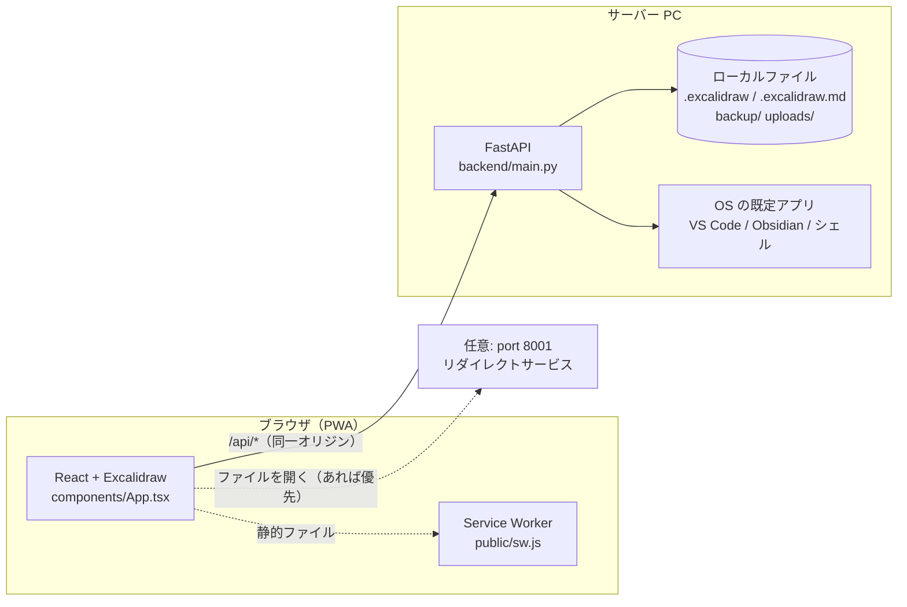
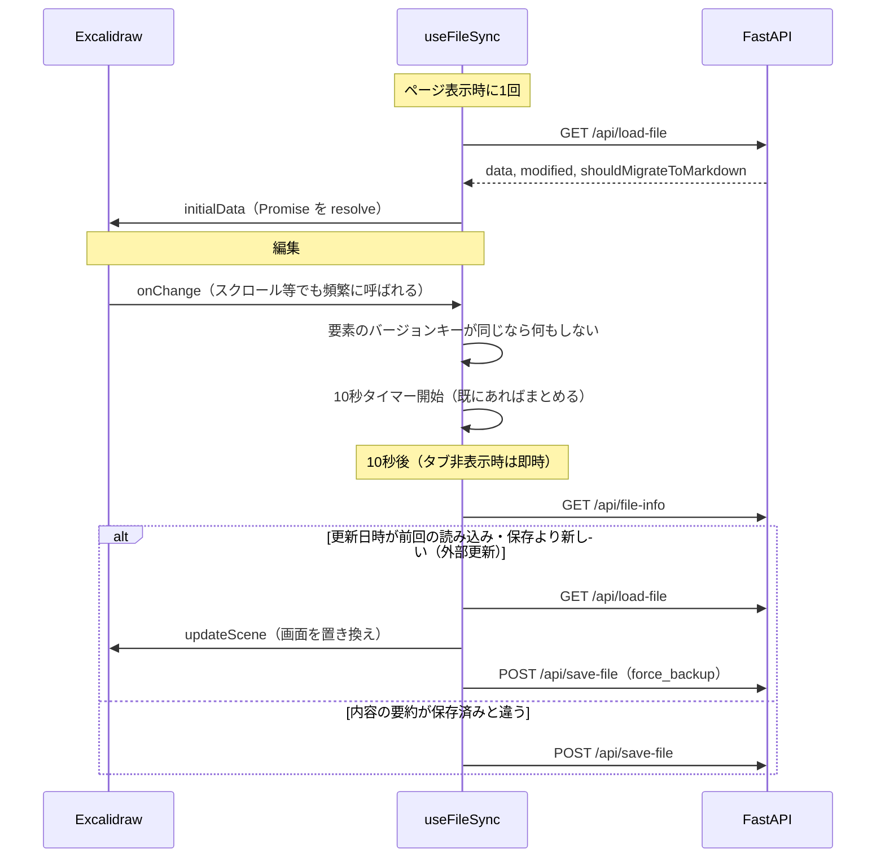

# アーキテクチャ

## 全体構成



- **本番**: FastAPI（port 3001）が `dist/`（ビルド済みフロントエンド）と API を同じオリジンで配信する
- **開発**: Vite（port 3001, HMR）が `/api`・`/save-library` を FastAPI（port 8008）へ proxy する
- フロントエンドは常に相対パスで API を呼ぶ（`utils/backendApi.ts` の `API_BASE_URL = ''`）
- ファイル操作・「OS で開く」は、ブラウザではなく **FastAPI を動かしている PC** で行われる

## フロントエンド

```
index.tsx                     エントリポイント（<App /> を描画）
components/
  App.tsx                     画面の組み立て。各フックとヘッダー・モーダルをつなぐ
  HeaderToolbar.tsx           左上のボタン群（チェックモード・新規作成など）
  EmbeddedNoteContextMenu.tsx 埋め込みノート画像の右クリックメニュー（フック + 表示）
  AnnotationSettingsModal.tsx マーカー・アンダーライン設定（, キー）
  ShortcutHelpModal.tsx       ショートカット一覧（. キー）
  App.scss                    スタイル
hooks/
  useFileSync.ts              読み込み・自動保存・外部更新の取り込み（下記）
  useKeyboardShortcuts.ts     独自ショートカット（チェックモードの連続描画を含む）
  useCheckModeStrokeColor.ts  チェックモードのオン / オフで描画色を赤 / 黒に切り替える
  useDragAndDrop.ts           ファイル・フォルダ・メールのドロップ
  useMousePosition.ts         マウス位置（ref で保持し再描画しない）
  useNotification.ts          右上の通知
utils/
  backendApi.ts               バックエンド API 呼び出しと型
  pathUtils.ts                パス・URL の純粋関数
  linkHandler.ts              図形リンクのクリック処理、OS で開く（8001 → FastAPI）
  embeddedMarkdown.ts         埋め込み Obsidian ノートの SVG 化
  svgExport.ts                SVG 書き出し
  sceneSummary.ts             自動保存の変更判定、保存する appState
  libraryItems.ts             共有ライブラリの読み込み・ID 振り直し・同期判定
  drawWatcher.ts              C/M/U キーの「次に描いた要素」の後処理（チェックモードの連続描画・チェックマークのクリック検知を含む）
  checkMarkUtils.ts           チェックモードのチェックマーク（✓）要素
  stickyNoteUtils.ts          付箋（N / W キー）
  dragDropUtils.ts            ドロップ用の付箋・画像要素、メール件名
  markerUtils.ts / underlineUtils.ts / annotationSettings.ts  マーカー・下線
  shortcutList.ts             ショートカット一覧のデータ
  localStorage.ts             localStorage モードの保存
  titleUtils.ts               タブタイトル
  resolvablePromise.ts        Excalidraw の initialData 用
```

### 読み込みと保存（`hooks/useFileSync.ts`）



- 保存と外部更新の確認は1つのキューで直列に実行する（自分の保存を外部更新と誤検知しない）
- 「変わったか」の判定は2段階: `onChange` ごとには要素の version/versionNonce から作る軽量キーだけを比べ、
  保存直前に内容の要約（位置・サイズ・スタイル・テキスト・頂点・リンク・グループ・重なり順など）を比べる
- 読み込みに失敗したファイル（JSON 不正など）は、空の図面で上書きしないよう保存を止める
- `filepath` がない場合は localStorage に保存する（外部更新の確認はしない）

## バックエンド

```
backend/
  main.py              ルーティング（API 一覧は docs/api.md）
  models.py            リクエスト・レスポンスのモデル
  storage.py           原子的な書き込み・バックアップ・JSON 検証・アップロード先
  obsidian_markdown.py .excalidraw.md の解析・生成（LZString 圧縮、Text Elements など）
  obsidian_files.py    Embedded Files の画像の解決（読み込み時）・書き出し（保存時）
  system_open.py       OS の既定アプリで開く・VS Code・コマンド実行
```

- ファイル I/O を行う API は同期関数（FastAPI のスレッドプールで実行され、イベントループを止めない）
- `backend/` から `uvicorn main:app`、プロジェクトルートから `uvicorn backend.main:app` のどちらでも起動できる
  （各モジュールは相対 import → 失敗時に同じフォルダからの import にフォールバックする）

## PWA（`public/sw.js`, `public/manifest.json`）

| リクエスト | 戦略 |
| --- | --- |
| `/api/*`・`*.excalidrawlib` | ネットワークのみ（キャッシュしない） |
| ハッシュ付きアセット（`/assets/*-xxxxxx.js/css/mjs`） | キャッシュファースト |
| その他（HTML など） | ネットワークファースト。ページ遷移は `/` としてキャッシュし、オフライン時に返す |

キャッシュ名（`excalidraw-pwa-v5` など）を変えると古いキャッシュは削除される。

## 起動スクリプト

| スクリプト | 内容 |
| --- | --- |
| `start_servers.sh` / `start_servers.bat` | 本番。npm と node_modules があればビルドし、port 3001 の既存プロセスを止めて FastAPI を起動。HTTP 応答を確認してから完了を表示。npm / node_modules がない環境（ビルドできない社内 PC など）では、git 管理されている `dist/` をそのまま使う |
| `start_dev.sh` | 開発。port 3001 / 8008 を解放して Vite と FastAPI を起動 |
| `backend/start_server.sh` | FastAPI だけを開発用（port 8008, --reload）で起動 |

Python は `backend/.venv` → `backend/venv` →（bat のみ `.venv` / `venv`）→ システムの `python` の順に探す。
