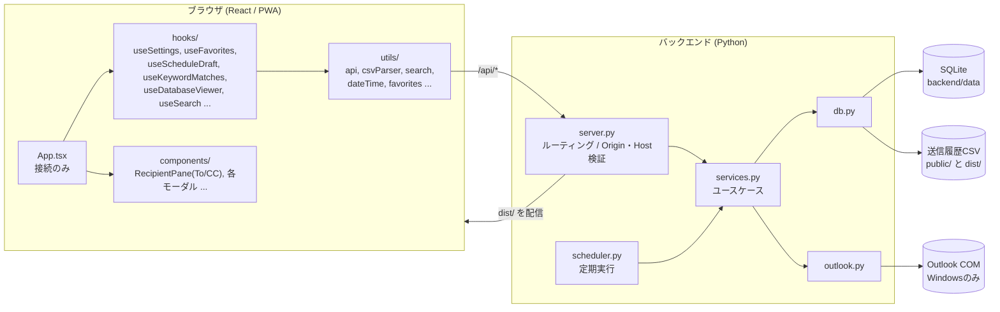

# Outlook宛先作成アプリ

## 概要

Outlookの送信履歴CSVとOutlook連携バックエンドを利用し、宛先（To）・CCを効率よく作成するアプリです。
フロントエンドはReact + Viteでビルドし、Pythonバックエンドが`dist`を静的配信します。

## アーキテクチャ

```
backend/
├── server.py              # HTTPサーバー（ルーティング表、Origin/Host検証、エラーコード、起動）
├── services.py            # ユースケース（アドレス再取得、キーワードチェック、予定解析・追加）
├── db.py                  # SQLite/CSV（スキーマ作成・移行、設定、お気に入り、宛先、一致、ジョブ履歴）
├── outlook.py             # Outlook COM（接続と復旧、送信済み取得、予定登録、職アド検索）
├── scheduler.py           # 自動実行（間隔判定、失敗時の再試行、多重起動防止）
├── config.py              # パス、既定設定、ログ設定
├── event_parser.py        # 自然文予定解析
├── testing.py             # テスト共通ヘルパー
├── test_*.py              # テスト（event_parser / db / services / outlook / scheduler / http_api）
└── requirements.txt       # Windows向けpywin32依存

src/
├── App.tsx                # hooksとコンポーネントの接続
├── components/            # AppHeader, SettingsPanel, ScheduleSection, KeywordMatchBanner,
│                          # RecipientPane, DatabaseModal, FavoriteModal, GlobalContextMenu,
│                          # ProfileCopyButtons, HtmlEditor, Toast, styles.ts
├── hooks/                 # useOperation, useToast, useSettings, useKeywordMatches, useFavorites,
│                          # useScheduleDraft, useDatabaseViewer, useRecipients, useSearch
├── utils/                 # api, csvParser, search, clipboard, dateTime, favorites, keywords,
│                          # databaseRows, dom, htmlSanitizer
├── types/index.ts
├── test/                  # テスト設定、フック用ヘルパー
└── main.tsx               # ReactマウントとService Worker登録

public/
├── icons/icon.svg
├── manifest.webmanifest
├── send_mail-ranking_tabulator.csv
└── sw.js
```

### 全体構成図



画面の状態は機能ごとのフック（`src/hooks/`）が持ち、`App.tsx` は接続だけを行います。副作用のない処理（日時変換、お気に入り展開、検索語の分割など）は`src/utils/`に置き、単体でテストしています。

## 起動

### バックエンド配信

```bash
npm run build
npm run backend
```

ブラウザで`http://127.0.0.1:8765`を開きます。

### 起動用ファイル

- Windows: `start_windows.bat`
- Mac: `start_mac.command`

`dist/index.html`が存在しない場合は、起動時に`npm ci`と`npm run build`を実行します。
Windows用の`start_windows.bat`は、起動前に指定ポート（既定: 8765）を使用中の既存プロセス停止を試みます。その後、バックエンドを別プロセスで起動し、ヘルスチェック成功後にブラウザを開きます。
ブラウザの自動起動を抑止する場合は、`OUTLOOK_ADDRESS_OPEN_BROWSER=0`を指定できます。

### 開発サーバー

```bash
npm run dev
```

Vite開発サーバーでは`/api`を`http://127.0.0.1:8765`へプロキシします。APIを使う場合は別ターミナルで`npm run backend`も起動します。

## 操作方法

1. 検索ボックスにキーワードを入力
2. Enterキーで検索実行（半角・全角スペース、カンマ(,)、読点(、、､)区切りでOR検索）
3. 検索結果から不要な宛先のチェックを外す
4. 「宛先作成」または「CC作成」ボタンをクリック
5. クリップボードにコピーされた文字列をOutlookに貼り付け

## バックエンド機能

- `POST /api/refresh-addresses`: Outlook送信済みアイテムから宛先を再集計し、CSVとSQLiteへ保存します。既存CSVにあり今回見つからなかった名前は回数0で残します。
- `POST /api/check-keywords`: 件名に「職アドからのお知らせ」を含む受信メールを確認し、登録キーワードに一致する本文行をSQLiteへ保存します。新規一致はレスポンスで返します。一致レコードは `confirmed=0`（未確認）で保存され、ユーザーが確認するまで画面に表示され続けます。
- `POST /api/parse-schedule`: 自然文の予定入力から件名、開始/終了日時、場所、終日予定を抽出します。
- `POST /api/add-schedule`: 解析済みまたは編集済みの予定をOutlook予定表へ追加します。
- `GET /api/settings`: キーワード、自動実行頻度、プロフィール（`my_email`など）を取得します。
- `PUT /api/settings`: 上記を保存します。不正な値は400で拒否します。
- `GET /api/favorites`: お気に入り（宛先とCCのセット）を取得します。
- `PUT /api/favorites`: お気に入り全体を保存します（`{"favorites": [...]}`）。
- `POST /api/favorites/add`: 1件のお気に入りを追加または更新します。
- `GET /api/keyword-matches`: 保存済みキーワード一致を取得します。`unconfirmed=1`を指定すると未確認（ユーザー未確認）の一致のみを返します。アプリ起動時にこのフィルタを使い、未確認通知を復元します。`new_only=1`は互換性のため空配列を返し、新規一致は`POST /api/check-keywords`のレスポンスで確認します。
- `POST /api/keyword-matches/confirm`: IDリスト（JSON: `{"ids": [...]}` ）を受け取り、該当レコードを確認済み（`confirmed=1`）に更新します。ユーザーが画面の「確認」ボタンを押したときに呼ばれます。
- `GET /api/database`: `settings`、`recipients`、`favorites`、`keyword_matches`、`job_runs`のスナップショットを取得します。
- `POST /api/database/delete`: `settings`以外のDBレコードを選択削除します。`recipients`削除時はCSVも同期更新します。
- `POST /api/seed-dummy-data`: Outlookを使えない環境で画面確認用のダミーデータを投入します。宛先一覧（DBとCSV）を上書きするため、画面は確認ダイアログを出します。
- `GET /api/health`: バックエンド状態、設定、ジョブ状態を取得します。

自動実行スケジューラはジョブ単位のロックを使い、同じジョブが実行中の場合は重複起動をスキップします。前回が失敗したジョブは、実行間隔に関わらず最大60分後に再試行します。
ブラウザからのAPIリクエストは同一Originのみ許可し、別OriginからのGET/POST/PUT/OPTIONSは403で拒否します。別Originに対する`Access-Control-Allow-Origin`は返しません。ループバックで待ち受けている間は、Hostヘッダーがローカル名でないリクエストも403で拒否します。

エラーのステータスは、入力不備が400、ボディが1MB超が413、不明なAPIが404、それ以外の例外が500です（`{"error": "..."}`）。

キャッシュ: `/api/*`は`no-store`、`/assets/*`（ハッシュ付き）は`immutable`、それ以外は`no-cache`です。

## PWA

`manifest.webmanifest`と`sw.js`を`public`に配置しています。ビルド時に`dist`へコピーされ、バックエンドから配信されます。
Service Workerはアプリ本体をキャッシュし、`/api`とCSVはキャッシュ対象外にしています。画面遷移とmanifest等はネットワーク優先、ハッシュ付きの`/assets/*`はキャッシュ優先（古いものは40件を超えた分から削除）です。動作を変えたら`public/sw.js`の`CACHE_NAME`を上げてください。

## CSVファイル

配置場所:

- 開発/元データ: `public/send_mail-ranking_tabulator.csv`
- バックエンド配信: `dist/send_mail-ranking_tabulator.csv`

```csv
名前,回数
山田 太郎,120
佐藤 一郎,200
```

名前にカンマを含む場合はダブルクォートで囲めます。フロントエンドの画面読み込みとバックエンドの既存CSVマージでは、回数が整数として読めない行は読み込み対象外です。フロントエンドはCSVを`no-store`で取得し、取得失敗時はエラーを表示します。

## テストと検証

```bash
npm run lint
npm run test:run       # フロントエンド
npm run test:backend   # バックエンド
npm run build
npm run lint:backend   # ruff + mypy（pip install -r backend/requirements-dev.txt）
```

`npm run test:all`でフロントとバックエンドのテストをまとめて実行できます。`npx vitest --run --coverage`でカバレッジを出力します。

## 技術スタック

- React 18 + TypeScript
- Vite 6
- Tailwind CSS
- Vitest + Testing Library
- Python 3.12 標準ライブラリ
- SQLite
- pywin32（WindowsでOutlook連携を使う場合）

## 設計・仕様ドキュメント

詳細な機能仕様や設計については、以下のドキュメントを参照してください。

- [全体仕様書](../spec.md)
- [お気に入りの宛先・CCワンセット管理機能 仕様書](favorites_spec.md)
- [除外キーワード機能 仕様書](exclude_keywords_spec.md)
- [HTML本文予定作成機能 仕様書](html_body_spec.md)
- [HTML貼り付けサニタイズ 設計仕様書](html_body_sanitize.md)
- [予定解析機能 仕様書](event_parser.md)
- [プロフィールかんたんコピー 仕様書](my_profile_spec.md)

図はMermaidで記述しています（GitHubやVS Codeのプレビューで表示できます）。
