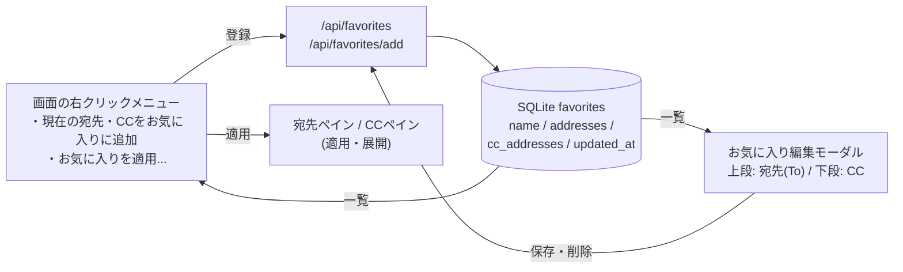

# お気に入りの宛先・CCワンセット管理機能 仕様書

## 1. 背景と目的
従来のお気に入り機能は、宛先（To）とCCの区別なく、アドレス一覧を単一の名前付きグループとして保存・コピー時に展開する動作でした。
しかし、実際のメール作成業務では「特定の宛先（To）に対して常にセットで指定すべきCC（例：プロジェクトメンバーや上司）」が存在するため、**宛先（To）とCCをワンセット（ペア）で保存・管理**したいというニーズがありました。

本機能拡張では、以下の内容を実現します。
- 宛先とCCのペアでのお気に入り保存・管理。
- 既存データ（旧お気に入り）の安全な引き継ぎ（自動マイグレーション）。
- トップページの右クリックメニューから一括登録および一括適用できるシームレスなUI。
- 宛先（To）とCCを上下に分割して個別に編集できる直感的な編集モーダル。

---

### 1.1. 全体の流れ



---

## 2. データベース設計とマイグレーション

### 2.1. テーブル設計
SQLiteの `favorites` テーブルの定義を以下のように拡張します。

```sql
CREATE TABLE IF NOT EXISTS favorites (
    name TEXT PRIMARY KEY,
    addresses TEXT NOT NULL,         -- JSON形式のリスト（To用）
    cc_addresses TEXT DEFAULT '[]',  -- JSON形式のリスト（CC用、新規追加）
    updated_at TIMESTAMP DEFAULT CURRENT_TIMESTAMP
);
```

### 2.2. マイグレーション
既存のデータベースファイルを破壊せずに安全に拡張するため、バックエンドサーバー起動時（`db.ensure_db`、DBファイルごとに初回のみ実行）に、`favorites` テーブルに `cc_addresses` カラムが存在するかチェックし、存在しない場合は自動的に `ALTER TABLE` を実行して追加します。

```python
# マイグレーション処理のコード例
cursor.execute("PRAGMA table_info(favorites)")
columns = [row[1] for row in cursor.fetchall()]
if "cc_addresses" not in columns:
    cursor.execute("ALTER TABLE favorites ADD COLUMN cc_addresses TEXT DEFAULT '[]'")
```

---

## 3. バックエンドAPIの仕様

### 3.1. `GET /api/favorites`
お気に入り一覧を取得します。

- **レスポンス**:
  ```json
  {
    "favorites": [
      {
        "name": "開発チーム",
        "addresses": ["山田 太郎", "佐藤 一郎"],
        "cc_addresses": ["鈴木 三郎"],
        "updated_at": "2026-05-27T10:00:00"
      }
    ]
  }
  ```

### 3.2. `PUT /api/favorites`
お気に入りリストを一括保存（全体を置き換え）します。名前が空の項目や、宛先・CCがどちらも空の項目は無視されます。内容が変わっていないお気に入りの `updated_at` は維持されます。

- **リクエストボディ**:
  ```json
  {
    "favorites": [
      {
        "name": "開発チーム",
        "addresses": ["山田 太郎"],
        "cc_addresses": ["鈴木 三郎"]
      }
    ]
  }
  ```
- **レスポンス**: `{"favorites": [...]}`（保存後の一覧）。`favorites` が配列でない場合は400。

### 3.3. `POST /api/favorites/add`
新しいお気に入りグループを個別に追加します（同名があれば置き換え）。宛先とCCがどちらも空、または名前が空の場合は400。レスポンスは `{"favorite": {...}, "favorites": [...]}`。

- **リクエストボディ**:
  ```json
  {
    "name": "新規グループ",
    "addresses": ["山田 太郎"],
    "cc_addresses": ["鈴木 三郎"]
  }
  ```

---

## 4. フロントエンド設計とUI/UX

お気に入りのTo/CC統合に伴い、フロントエンドのインターフェースおよび状態管理を以下のように変更しました。

```
+-------------------------------------------------------------------+
|                        [ トップページ全体 ]                       |
|  (右クリック) ---> [ カスタムコンテキストメニュー ]               |
|                     * 📁 現在の宛先・CCをお気に入りに追加         |
|                     * お気に入りを適用...                         |
|                         └ 開発チーム (To: 1, CC: 1)               |
|                         └ 新しいグループ (To: 1, CC: 0)           |
+-------------------------------------------------------------------+
```

### 4.1. 右クリック（カスタムコンテキストメニュー）
- **動作**: トップページ全体の余白や要素の右クリックで、ブラウザ標準メニューを抑止（`e.preventDefault()`）し、カスタムフローティングメニューを表示。
- **メニュー項目**:
  - `📁 現在の宛先・CCをお気に入りに追加`: 現在宛先ペインおよびCCペインでチェックされているアドレスを取得し、`window.prompt` でグループ名を入力させて `addFavorite` APIを呼び出します。
  - `お気に入りを適用...`: 登録されているお気に入りグループを選択可能なボタンとして展開。「お気に入りグループ名 (To: X, CC: Y)」の形式で表示し、クリックすると宛先・CCペインそれぞれのチェック状態に一括反映・適用されます。
    - **お気に入り適用バッジによる識別表示**: お気に入り適用時、検索窓（テキストエリア）は完全に空（クリア）に保たれ、その代わり検索窓の直上に `★ お気に入り「[お気に入り名]」適用中` というスタイリッシュなピン留めバッジ（解除ボタン付き）が表示されます。これにより、余分なキーワードで検索窓を汚して「未検出」エラーが出るようなことがなくなり、どのお気に入りが適用されているか視覚的にも美しく表現されます。
    - **無関係なアドレスの自動除外**: このピン留めバッジが表示されている（お気に入り適用中であり、かつ新規検索を行っていない）間、リストには**お気に入りとしてチェックされているアドレスのみ**が表示され、関係のない無関係なアドレス（CSVメンバーや別のお気に入りメンバー）は一切表示されず、画面がすっきりと保たれます。
    - **お気に入りを保持したままの追加検索機能**: お気に入り適用中、さらに宛先を手動で追加したい場合は、通常どおり検索窓（テキストエリア）に検索語を入力してEnterを押すだけです（例: `山田`）。検索を実行しても、現在お気に入りでチェックされているアドレスの選択状態は**消去されずに完全に保持（マージ）され**、画面には現在のお気に入りメンバーと新しく「山田」にマッチするCSVメンバーが同時にチェックされた状態でリスト表示されます。これにより、お気に入りの選択状態を壊さずに安全に追加できます。バッジの「解除 ✕」をクリックすると、現在のチェック状態を維持したまま、CSV全体の表示に戻ります。

### 4.2. 上下分割されたお気に入り編集モーダル
モーダル内の「アドレス編集」領域を上下に分割しました。また、**画面幅に関わらず常に左ペイン（お気に入り一覧）と右ペイン（詳細編集領域）の2カラムレイアウトを維持**するレスポンシブ設計となっています。幅が小さくなった場合でも縦並び（1カラム化）によって一覧が縦長に肥大化し編集エリアを圧迫するのを防ぎ、画面サイズを問わず広い時と同じ使い心地（インターフェース）を提供します。

- **レイアウト構想**: 左ペイン（幅固定/最小幅確保: 130px〜240px）、右ペイン（柔軟幅: minmax(0,1fr)）。
- **上段**: 宛先（To）のリストを改行区切りテキストエリアで編集。
- **下段**: CCのリストを改行区切りテキストエリアで編集。
- **保存処理**: 保存ボタンのクリックにより、それぞれの改行区切りテキストをパースしてJSONリスト形式にし、`saveFavorites` APIを実行してバックエンドと同期します。

```
+-------------------------------------------------------------+
| お気に入りの編集 - [グループ名]                             |
+-------------------------------------------------------------+
| 宛先（To）のリスト（改行区切り）                            |
| +---------------------------------------------------------+ |
| | 山田 太郎                                               | |
| | 佐藤 一郎                                               | |
| +---------------------------------------------------------+ |
|                                                             |
| CCのリスト（改行区切り）                                    |
| +---------------------------------------------------------+ |
| | 鈴木 三郎                                               | |
| +---------------------------------------------------------+ |
+-------------------------------------------------------------+
|                        [ 保存 ] [ 閉じる ]                  |
+-------------------------------------------------------------+
```

---

## 5. テスト設計と検証

### 5.1. バックエンドテスト (`backend/test_db.py`, `backend/test_http_api.py`)
- **データベースのマイグレーション検証**: 起動時に旧形式の `favorites` テーブル（`cc_addresses`なし）が存在する場合に、自動で `cc_addresses` が追加され既存データが損なわれないかをテスト。
- **保存処理の検証**: `save_favorites` / `add_favorite` で `cc_addresses` が正しく処理・保存・返却されること、未変更項目の `updated_at` が維持されることをテスト。

### 5.2. フロントエンドテスト (`src/App.test.tsx` / `src/hooks/useFavorites.test.ts` / `src/utils/favorites.test.ts` / `RecipientPane.test.tsx`)
- **上下分割編集の検証**: お気に入り編集モーダルで宛先（To）とCCのテキストエリアがそれぞれ表示され、編集内容が `saveFavorites` APIに正しく渡されるかをテスト。
- **右クリックメニューの検証**:
  - 右クリック時にメニューが表示されること。
  - 現在の選択状態が `addFavorite` APIに正しく渡されること。
  - メニューからお気に入りグループを選択した際に、宛先・CCペインへ適用されること（Testing Libraryを用いたボタン検索とクリック）。
