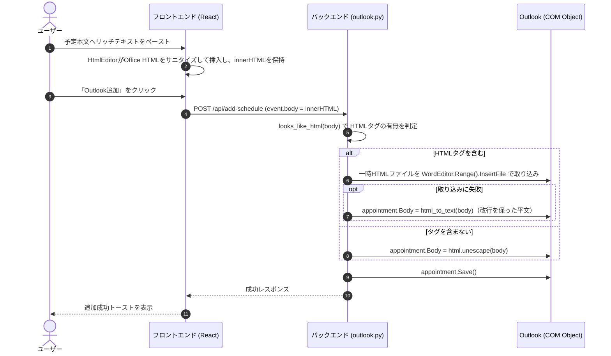

# 予定本文HTML貼り付け・Outlook連携仕様書

## 概要
予定（Outlook AppointmentItem）の本文に、プレーンテキストだけでなく、リッチテキスト（リンク・表・文字装飾）の貼り付けをサポートし、Outlook予定表へ反映します。

クラシックOutlookの予定アイテムには `HTMLBody` プロパティが無いため、HTML本文は一時HTMLファイルを作り、予定の編集エンジン（`WordEditor`）の `InsertFile` で取り込みます。フロントエンドでのサニタイズの要件は [html_body_sanitize.md](html_body_sanitize.md) を参照してください。

---

## 処理フロー

---

## 詳細設計

### 1. フロントエンド (`src/components/HtmlEditor.tsx`)
Reactの `contenteditable` を制御コンポーネントとして `value` と同期させると、キー入力ごとに `innerHTML` を更新してしまい、日本語入力（IME）中にカーソルが飛びます。これを避けるため、次の設計にしています。

- **非制御的な同期**: 外部からの `value` の変更（予定解析の実行など）のときだけ `innerHTML` を書き換えます。
- **入力の反映**: タイピング中は状態へ書き戻さず、`onBlur`（フォーカスアウト）時に `innerHTML` を `onChange` で通知します。貼り付け時は即時に通知します。
- **貼り付け**: クリップボードに `text/html` があれば `sanitizeHtml` でOffice特有の要素を取り除いてから挿入します。無ければブラウザ標準の貼り付けに任せます。
- 本文エディタの編集中は、左右矢印キーをペイン切り替えに使いません（`utils/dom.ts` の `isTextEntryTarget`）。

エディタの値は**常にHTML文字列**です。平文を入力しても `&` は `&amp;` に、改行は `
` や ` ` になって渡されます。

### 2. バックエンドの本文の扱い (`backend/outlook.py` の `set_appointment_body`)

- **HTML判定** (`looks_like_html`): `</?英字...>` の形のタグ（` `、`<b>`、`
`、`<a href=...>` など）が1つでもあればHTMLとみなします。`A &amp; B`、`1 &lt; 2`、`a < b and c > d` のようにタグではない文字列はHTMLとみなしません。
- **HTMLの場合**: UTF-8の一時HTMLファイルを作り、`appointment.GetInspector.WordEditor.Range().InsertFile(path)` で取り込みます。一時ファイルは取り込み後に必ず削除します。これにより、HTMLタグがテキストとして露出せず、リンクや表を再現できます。
- **取り込みに失敗した場合**: 警告ログを出し、`html_to_text` でタグを除いた平文（` `・`
`・`
` などは改行に変換、`<script>`・`<style>` の中身は除去）を `appointment.Body` に設定します。処理は中断しません。
- **タグを含まない場合**: `html.unescape` でHTMLエンティティを元の文字に戻して `appointment.Body` に設定します（`A &amp; B` → `A & B`）。

### 3. テスト
- `backend/test_outlook.py`: `looks_like_html`、`html_to_text`、HTML/平文/フォールバックそれぞれの登録内容
- `src/components/HtmlEditor.test.tsx`: 値の反映、`onBlur` の通知、貼り付けのサニタイズ
- `src/utils/htmlSanitizer.test.ts`: サニタイズの要件
