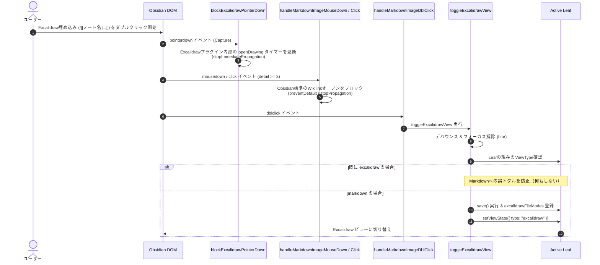

# Excalidraw埋め込みのダブルクリックによるビュー切り替え 仕様書

## 概要
Markdownノート内に埋め込まれたノート自身と同名のExcalidraw埋め込み（例: `りんご.md` 内の `![[りんご|75]]`）をダブルクリックした際、現在のタブを Excalidraw ビューに切り替える。

## 背景と目的
ExcalidrawバックのMarkdownノート（フロントマターに `excalidraw-plugin: parsed` を持つファイル）では、Markdown本文中に自身の図面データが埋め込まれている場合がある。
この埋め込み画像をダブルクリックした際に、Excalidrawプラグイン内部の `pointerdown` タイマーや `dblclick` リスナー（`openDrawing`）が発火して `.md` を MarkdownView で開き直してしまう問題を遮断し、確実にExcalidrawの描画編集画面（Excalidrawビュー）へとスムーズに移行できるようにする。

## 仕様詳細

### 1. 対象条件の判定 (`isSelfExcalidrawParsedEmbed`)
- クリックされた埋め込み要素から解決されたファイル `file` が存在すること。
- 現在開いているノート `activeFile` が存在すること。
- 両ファイルが Markdown ファイル（`.md`）であること。
- 開いている Markdown ファイルと埋め込み対象のファイルが同一（パスまたはベース名が一致）であること。
- 対象ファイルのフロントマターに `excalidraw-plugin: "parsed"` が設定されていること。

### 2. イベント伝播の遮断 (`blockExcalidrawPointerDown`)
- Excalidrawプラグインは、Markdown内の埋め込み要素に対して `pointerdown` 時にタイマーを仕掛け、`openDrawing` を実行する。
- キャプチャフェーズで `pointerdown` イベントを捕捉し、対象が自身と同名の埋め込みであれば `e.stopPropagation()`, `e.stopImmediatePropagation()` を実行して Excalidraw プラグイン内部のタイマー発火を根元から阻止する。
- 押された埋め込みの特定（`getExcalidrawFileFromPointerEvent`）は、Markdown の本文（`.markdown-preview-view` / `.markdown-source-view`）の中だけで行う。
  - Excalidraw ビュー（`.workspace-leaf-content[data-type='excalidraw']`）の中と、本文の外側（サイドバーなど）の操作は対象にしない。
  - 子孫の `fileSource` を探すのは埋め込みの枠（`.internal-embed` / `.media-embed` / `.image-embed` / `.markdown-embed` / `.excalidraw-svg`）だけにする。
  - 以前は `body` などの外側の要素でも子孫を探していたため、別のタブに同じ図の埋め込みがあると、Excalidraw の描画画面のクリックまで「自身と同名の埋め込み」と判定して止めていた。そのため描画画面で図形を描けず、`pointerdown` を使わないダブルクリックの文字入力だけができる状態になっていた。右クリックの遮断（`blockExcalidrawRightButtonEdit`）も同じ判定を使う。
- テスト: [scratch/test_excalidraw_view_pointer_passthrough.js](../scratch/test_excalidraw_view_pointer_passthrough.js)

### 3. 切り替え処理 (`toggleExcalidrawView`)
- 対象条件を満たす場合：
  1. イベントのデフォルト動作および伝播をブロック（`e.preventDefault()`, `e.stopPropagation()`, `e.stopImmediatePropagation()`）。
  2. デバウンス処理（800ms以内の連続呼び出しを無視）により重複実行を防止。
  3. 現在のアクティブ要素のフォーカスを解除（`blur()`）。
  4. 現在のアクティブリーフのビュータイプを判定：
     - **すでに `excalidraw` ビューの場合**: トグル処理（Markdownへの戻り）を行わず、そのまま維持。
     - **`markdown` ビューの場合**: ノートを保存（`save()`）し、`excalidrawFileModes` を設定した上で `leaf.setViewState({ type: "excalidraw", ... })` を実行して確実に Excalidraw ビューに切り替える。

### 4. ダブルクリック競合・誤オープンの防止 (`handleMarkdownImageMouseDown`, `handleMarkdownImageClick`)
- `mousedown` / `click` イベントにおいて `e.detail >= 2`（ダブルクリック以上の操作）を検知した際、対象ファイルが自身と同名の Excalidraw 埋め込みであれば `preventDefault()` および `stopPropagation()` を実行し、Obsidian標準のリンク展開（Wikilinkオープン）やカーソル移動を確実に防止する。

## 処理フロー

