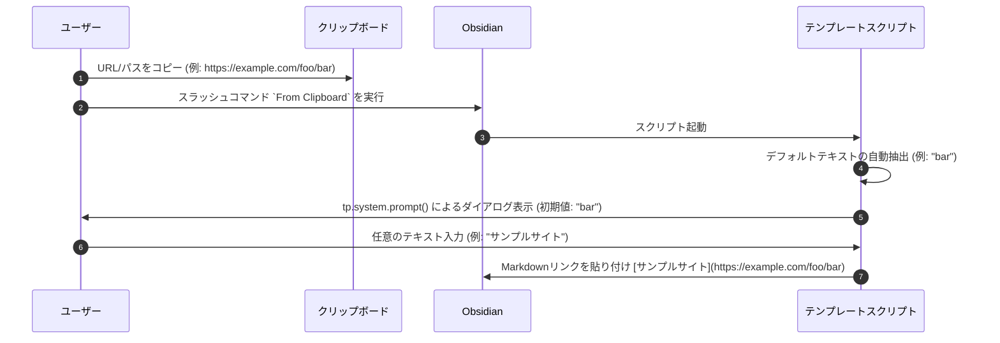

# クリップボードからのリンク貼り付け時の表示テキスト編集仕様

## 1. 概要
`From Clipboard` スラッシュコマンド（Templater テンプレート）でURLやファイルパスからMarkdownリンクを生成する際、自動抽出されたテキスト（ドメイン名やURLの末尾セグメント）をデフォルト値としつつ、ユーザーが任意の表示テキストを入力できるプロンプトを表示するように改善します。

## 2. ユーザー体験（UX）フロー

### 動作詳細

1. **ダイアログ表示**
   - クリップボードの内容がURLまたはファイルパスであると判定された場合、ダイアログが表示されます。
   - メッセージ: `リンクの表示テキストを入力してください:`
   - デフォルト入力値: 自動で抽出された従来の `linkText` (例: URLの末尾セグメントやドメイン名)
   - **テキストの自動選択 (UX改善)**:
     ダイアログ表示時、初期入力値（デフォルトテキスト）が入力ボックス内で**自動的に全選択（`select()`）された状態**になります。これにより、ユーザーは既存の文字を消すことなく即座に上書き入力することができ、デフォルト値をそのまま使いたい場合は何もせずに確定（Enter）するだけで適用されます。

2. **ユーザー入力結果に応じた処理**
   - **文字を入力して確定**:
     ユーザーが入力した任意の文字列を表示テキストとして使用し、`[入力テキスト](URL)` のような形式でリンクを出力します。
   - **未入力（空文字）で確定**:
     自動で抽出された従来のデフォルトテキストにフォールバックしてリンクを出力します。
   - **キャンセル**:
     ダイアログをキャンセル（Escキーやキャンセルボタン）した場合、自動で抽出された従来のデフォルトテキストにフォールバックしてリンクを出力します。

## 3. 影響範囲と変更ファイル
- 影響範囲: `From Clipboard` テンプレートおよびカスタムスラッシュコマンドによるMarkdownリンク挿入機能。
- 変更ファイル:
  - `00_templates/From Clipboard.md`
  - `00_templates/RegisterCustomCommands.md`（本体は `80_script/register_custom_commands/11_from_clipboard.js`）

## 4. SharePoint URL の UNC パス変換
ホスト名が `ghi` で始まる `http` / `https` の URL（SharePoint）は、そのままリンクにすると Edge で開いてしまうため、UNC パスに変換してから通常のファイルパスと同じリンクにする（`convertSharePointUrlToUnc`）。

- 前処理（すべての単一行入力）: 前後の空白と引用符を外したあと、末尾の `%0d`・`%0a`（大文字小文字不問）・改行・空白を取り除く。
- 接続方式: `http` → `\\ホスト@80\`、`https` → `\\ホスト@SSL\`。ポートが URL に明示されていれば `@ポート`（`https` は `@SSL@ポート`）。
- パス（上から順に探す。クエリのパラメータ名は大文字小文字を区別しない）:
  0. `_layouts/15/start.aspx#/<ページ>?<クエリ>`（SharePoint 2013 以降の MDS 形式）は、`#` 以降が実際のページなので、サイトのパスに組み直してから読む。
  1. クエリ `id` → `RootFolder` → `sourcedoc` → `parent`。値が `/` で始まるか、`http(s)://` の URL（パス部分だけ使う）のものだけを採用する（`DispForm.aspx?ID=123` の項目番号や `sourcedoc={GUID}` はパスではないため）。値は `URLSearchParams` が一度デコードする（エンコードされていない値もそのまま使える）。二重エンコード（`%252F`）はもう一度デコードする。`FolderCTID` / `viewpath` / `View` などは見ない。
  2. 短縮リンク `https://host/:f:/r/<パス>` の `<パス>`（`:x:` `:b:` など種類は問わない）。`/:f:/s/…` `/:x:/t/…` のような共有 token 形式は解決できないため変換しない。
  3. `pathname` をデコードしたもの（ファイルへの直リンク）。`/_layouts/` を含む内部ページ（`Doc.aspx?sourcedoc={GUID}` など）はパスではないため変換しない。
- 区切りを `\` に揃え、連続する区切りと末尾の区切りは取り除く。値の途中に混ざった改行などの制御文字（`%0d`）も取り除く。
- パスの末尾が `.aspx` のページ名（`AllItems.aspx` / `DispForm.aspx` など）なら、そのファイル分を除いて親フォルダまでにする。`Forms` 配下のページ（`/site/Forms/AllItems.aspx`）は、`Forms` もライブラリのフォルダではないため除き、ライブラリのフォルダ（`\site`）まで戻る。ファイルへの直リンクは、ファイルのパスのまま。
- 変換できない場合（パスが空、URL として解釈できない、`ghi` で始まらない、上記のどこにもパスが無い）は従来どおり URL のまま扱う。
- リンク先は `http://localhost:8001/api/open-path?path=<UNCパス>`、表示テキストの既定値は変換後パスの最後のフォルダ名。
- 変換例: `http://ghi1111.aaa.co.jp/PIA_Doc/Forms/AllItems.aspx?...&id=%2FPA%5FDoc%2F20%5FPLM%2F10%5F会議説明資料%0d` → `\\ghi1111.aaa.co.jp@80\PA_Doc\20_PLM\10_会議説明資料`
- 実装: `80_script/register_custom_commands/11_from_clipboard.js` と `00_templates/From Clipboard.md`（同じ実装が2か所にある）。テスト: `scratch/test_from_clipboard.js`。

## 5. 変更履歴
- **2026-05-23**: 新規仕様策定および実装（TDDによる検証を含む）。
- **2026-05-23 (追加)**: プロンプト表示時のデフォルトテキスト自動全選択（`select()`）仕様を追加・実装。
- **2026-10-26**: SharePoint URL の UNC パス変換と、末尾 `%0d` の除去を追加。
- **2026-10-29**: UNC パスの末尾が `.aspx` のとき、親フォルダにする処理を追加。
- **2026-10-29 (追加)**: パスの取得元を `id` → `RootFolder` → `sourcedoc` → 短縮リンク → `pathname` の順に拡張。`Forms/…aspx` はライブラリのフォルダまで戻す。
- **2026-10-29 (全パターン対応の見直し)**: `start.aspx#` 形式、`sourcedoc` の完全な URL、`parent`、値の途中の改行、末尾の `%0a` に対応。
