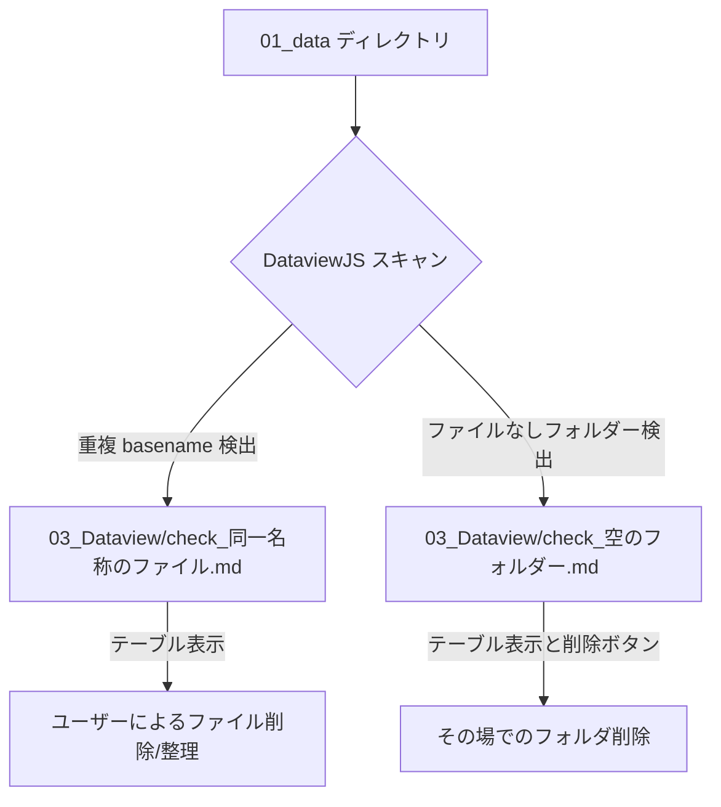

<!--
仕様:
1. docs/view_maintenance_tools.md を作成し、同一名称のファイル一覧および空のフォルダー一覧機能の設計・利用方法を説明する。
2. DataviewJS を用いた動的抽出ロジックの概要、動作要件（Dataviewプラグインのインストール）、画面イメージの設計を示す。
-->

# 重複ファイル・空フォルダー管理ツールの設計と使い方

本ドキュメントは、`01_data` 配下の不要なファイルを整理するための「同一名称のファイル（重複ファイル）一覧」および「空のフォルダー一覧」を表示する機能について、設計と使い方を説明します。

---

## 1. 概要

Vault内の整理・クリーンアップを効率化するため、コミュニティプラグインの **Dataview (DataviewJS)** を用いて、`01_data` ディレクトリ配下をスキャンし、問題のあるファイルを動的に一覧化します。

---

## 2. 動作要件

本機能を利用するには、以下の準備が必要です。

1. **Dataview プラグインの有効化**:
   - Obsidian の `設定` ➔ `コミュニティプラグイン` ➔ `Dataview` がインストールされ、有効化されていること。
2. **DataviewJS の有効化**:
   - `設定` ➔ `Dataview` プラグイン設定内の **Enable DataviewJS** を ON に設定していること。

---

## 3. 各ツールの詳細仕様

### 3.1 同一名称のファイル一覧 (`03_Dataview/check_同一名称のファイル.md`)

- **対象**: `01_data/` 配下の全ファイルのうち、指定された拡張子を持つもの。
- **処理ロジック**:
  1. 画面上部にある「対象の拡張子 (カンマ区切り):」インプットボックス（初期値: `md, ExcaliDraw.md`）に入力された拡張子リストに基づいて、`01_data/` 配下のファイルをフィルタリングします。
     - インプットボックスの入力値は `localStorage` に自動的に保存され、次回ツールを開いたときにもその設定値が自動的に復元されます。
     - インプットボックスの値が変更されると、即座に動的な再フィルタリングと再レンダリングを実行します。
  2. フィルタリングされたファイルを、拡張子を除いたファイル名（basename）の小文字でグループ化します。
  3. 異なるパスに存在する2つ以上のファイルを持つグループ（重複）のみを抽出します。
  4. 重複したファイル群を「要整理」と「問題なし」の2つのテーブルに分けて表示します。
  5. チェック状態を `localStorage` (キー: `obsidian_duplicate_checked_basenames`) に保存・復元します。
- **表示項目**:
  - **確認**: チェックボックス。チェックすると「問題なし（下部テーブル）」に移動し、外すと「要整理（上部テーブル）」に戻ります。
  - **操作**: 「比較」ボタン。クリックすると、その重複している同一名称のファイル群をすべて新規タブで一括して開きます。これにより、内容の比較や編集が容易になります。
  - **ファイル名 (basename)**: 太字で表示。
  - **パスとリンク**: 該当ファイルへのリンク。クリックしてその場（または別タブ）で開くことができます。
  - **拡張子**: 各ファイルの拡張子。
  - **更新日時**: `YYYY-MM-DD HH:mm:ss` 形式。

### 3.2 空のフォルダー一覧 (`03_Dataview/check_空のフォルダー.md`)

- **対象**: `01_data/` 配下の全フォルダー（`01_data` 自身は除く）。
- **処理ロジック**:
  1. `01_data/` 配下のフォルダーリストとファイルリストを取得します。
  2. サブフォルダーも含めて、中にファイルが1つも存在しないフォルダーを特定します。
  3. 空のフォルダーパスをアルファベット順にソートし、テーブル形式で出力します。
- **表示形式**:
  - **空のフォルダーパス**: フォルダーのパス文字列。
  - **操作**: 「開く」ボタンと「削除」ボタンが配置されます。
    - **開く**: Electron の `shell.openPath` を介して、OS のデフォルトのファイルブラウザー（Mac の Finder、Windows のエクスプローラー等）で該当フォルダーを開きます。
    - **削除**: クリックすると確認プロンプトが表示され、同意後にフォルダーがシステムゴミ箱に退避され、300ms の遅延の後にテーブル全体が自動で再スキャン・再描画（更新）されます。これにより、削除の結果新しく空になった親フォルダーも即座にリストに反映されます。

### 3.3 「無題のファイル」を含むファイル一覧 (`03_Dataview/check_無題のファイル.md`)

- **対象**: Vault 内の全ファイルのうち、ファイル名（拡張子込み）に検索語を含むもの。初期値は `無題のファイル`。`.base` や `.excalidraw.md` など拡張子は問わない。ただし `03_Dataview/` 配下のファイルは対象外（この一覧ツール自身が名前に「無題のファイル」を含むため）。
- **処理ロジック**:
  1. 画面上部の入力欄の検索語（`localStorage` のキー `obsidian_untitled_file_keyword` に保存・復元）で `app.vault.getFiles()` を絞り込みます。入力を変えると即座に再描画します。
  2. 更新日時の新しい順に並べます。
- **表示形式**: ファイル名（リンク）、操作（「開く」「削除」）、パス（親フォルダー）、更新日時の順。開いて確認したあと、マウスを大きく動かさずに削除できるよう、操作列をファイル名のすぐ右に置く。
  - **開く**: 新規タブで開きます。
  - **削除**: 確認後にゴミ箱へ移動し、300ms 後に再スキャンして表を更新します。

### 3.4 中身が空のファイル一覧 (`03_Dataview/check_中身が空のファイル.md`)

- **対象**: `01_data/` 配下の全ファイルのうち、次のいずれかに当てはまるもの。
  - **0バイト**: 拡張子を問わない。
  - **空白のみ**: Markdown（`.md`）で、空白・改行しかないもの。
  - **フロントマターのみ**: Markdown で、`---` で囲まれた部分だけで本文が無いもの。画面上部のチェックボックスで含めるか切り替えられ、`localStorage` のキー `obsidian_empty_file_include_frontmatter_only` に保存・復元されます。
- **処理ロジック**: `app.vault.cachedRead` で Markdown の本文を読んで判定し、更新日時の新しい順に並べます。`03_Dataview/` 配下は対象外です。
- **表示形式**: ファイル名（リンク）、操作（「開く」「削除」）、理由、パス、更新日時の順。操作列はファイル名のすぐ右にあります。
  - **開く**: 新規タブで開きます。
  - **削除**: 確認後にゴミ箱へ移動し、300ms 後に再スキャンして表を更新します。

---

## 4. メンテナンス手順

1. **同一名称のファイル整理**:
   - [同一名称のファイル](file:///Users/mine/000_work/obsidian-dagnetz/03_Dataview/check_同一名称のファイル.md) を開きます。
   - 「要整理」テーブル内の重複ファイルを確認し、内容をマージするか、不要な方を削除します。
   - 重複があっても問題のないファイル（例: 同名だが役割が異なる画像など）については、左端のチェックボックスを ON にして、下の「問題なし」テーブルへ移動させます。
   - チェック状態は自動保存されます。
2. **空フォルダーの整理**:
   - [空のフォルダー](file:///Users/mine/000_work/obsidian-dagnetz/03_Dataview/check_空のフォルダー.md) を開きます。
   - リストアップされた空フォルダーの右端にある「開く」ボタンをクリックし、OS のエクスプローラー上で中身が空であることを実際に目視確認します。
   - 確認後、「削除」ボタンをクリックします。
   - 確認ダイアログで「OK」をクリックすると、フォルダーがシステムゴミ箱へ移動し、300ms 後に全体が再スキャンされ、リストが自動更新されます（親フォルダーが新しく空フォルダーに昇格した場合も、自動でリストに加わります）。
