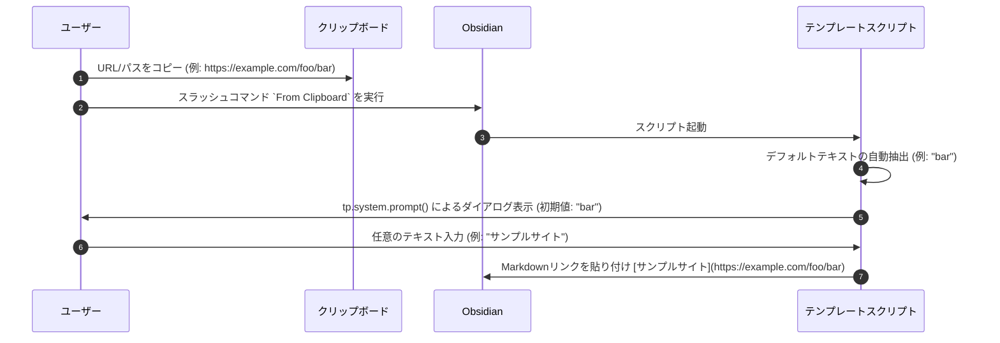

# クリップボードからのリンク貼り付け時の表示テキスト編集仕様

## 1. 概要
`From Clipboard` スラッシュコマンド（Templater テンプレート）でURLやファイルパスからMarkdownリンクを生成する際、自動抽出されたテキスト（ドメイン名やURLの末尾セグメント）をデフォルト値としつつ、ユーザーが任意の表示テキストを入力できるプロンプトを表示するように改善します。

## 2. ユーザー体験（UX）フロー

### 動作詳細

1. **ダイアログ表示**
   - クリップボードの内容がURLまたはファイルパスであると判定された場合、ダイアログが表示されます。
   - メッセージ: `リンクの表示テキストを入力してください:`
   - デフォルト入力値: 自動で抽出された従来の `linkText` (例: URLの末尾セグメントやドメイン名)
   - **テキストの自動選択 (UX改善)**:
     ダイアログ表示時、初期入力値（デフォルトテキスト）が入力ボックス内で**自動的に全選択（`select()`）された状態**になります。これにより、ユーザーは既存の文字を消すことなく即座に上書き入力することができ、デフォルト値をそのまま使いたい場合は何もせずに確定（Enter）するだけで適用されます。

2. **ユーザー入力結果に応じた処理**
   - **文字を入力して確定**:
     ユーザーが入力した任意の文字列を表示テキストとして使用し、`[入力テキスト](URL)` のような形式でリンクを出力します。
   - **未入力（空文字）で確定**:
     自動で抽出された従来のデフォルトテキストにフォールバックしてリンクを出力します。
   - **キャンセル**:
     ダイアログをキャンセル（Escキーやキャンセルボタン）した場合、自動で抽出された従来のデフォルトテキストにフォールバックしてリンクを出力します。

## 3. 影響範囲と変更ファイル
- 影響範囲: `From Clipboard` テンプレートおよびカスタムスラッシュコマンドによるMarkdownリンク挿入機能。
- 変更ファイル:
  - `00_templates/From Clipboard.md`
  - `00_templates/RegisterCustomCommands.md`（本体は `80_script/register_custom_commands/11_from_clipboard.js`）

## 4. SharePoint URL の UNC パス変換
ホスト名が `ghi` で始まる `http` / `https` の URL（SharePoint）は、そのままリンクにすると Edge で開いてしまうため、UNC パスに変換してから通常のファイルパスと同じリンクにする（`convertSharePointUrlToUnc`）。

- 前処理（すべての単一行入力）: 途中で改行された URL を1行に繋ぎ（「6. コピーの形ごとの扱い」を参照）、前後の空白と引用符を外し、文章や記号に囲まれていれば URL だけを取り出したあと（「5. リンクの安全な組み立て」を参照）、Safe Links を元の URL に戻し、末尾の `%0d`・`%0a`（大文字小文字不問）・改行・空白を取り除く。
- 接続方式: `http` → `\\ホスト@80\`、`https` → `\\ホスト@SSL\`。ポートが URL に明示されていれば `@ポート`（`https` は `@SSL@ポート`）。
- パス（上から順に探す。クエリのパラメータ名は大文字小文字を区別しない）:
  0. `_layouts/15/start.aspx#/<ページ>?<クエリ>`（SharePoint 2013 以降の MDS 形式）は、`#` 以降が実際のページなので、サイトのパスに組み直してから読む。
  1. 一覧画面でフォルダを移動した後のハッシュ `#InplviewHash<GUID>=FolderCTID%3D…-RootFolder%3D%252Fsite%252Ffolder-Paged%3D…`。ページを読み直さずハッシュだけが変わり、クエリは移動前の値のまま残るため、クエリより優先する。全体が1回、`RootFolder` の値がさらに1回エンコードされている（日本語は `%25E8…`）。名前の `-` は値の中でもエンコードされないため、`-名前=` が続く位置までを値とする。`RootFolder` の無いハッシュは無視する。
  2. クエリ `id` → `RootFolder` → `sourcedoc` → `parent`。値が `/` で始まるか、`http(s)://` の URL（パス部分だけ使う）のものだけを採用する（`DispForm.aspx?ID=123` の項目番号や `sourcedoc={GUID}` はパスではないため）。値は `URLSearchParams` が一度デコードする（エンコードされていない値もそのまま使える）。多重エンコード（`%252F`）はさらにデコードする。`FolderCTID` / `viewpath` / `View` などは見ない。
  3. 短縮リンク `https://host/:f:/r/<パス>` の `<パス>`（`:x:` `:b:` など種類は問わない）。`/:f:/s/…` `/:x:/t/…` のような共有 token 形式は解決できないため変換しない（URL のままリンクにする。「6. コピーの形ごとの扱い」を参照）。
  4. `pathname` をデコードしたもの（ファイルへの直リンク）。`/_layouts/` を含む内部ページ（`Doc.aspx?sourcedoc={GUID}` など）はパスではないため変換しない。
- デコードは `%XX` の並びごとに行う（`decodeUriSafely`）。名前に `%` が入っていて値全体をデコードできない場合でも、その `%` だけを残して日本語はデコードする。
- 区切りを `\` に揃え、連続する区切りと末尾の区切りは取り除く。値の途中に混ざった改行などの制御文字（`%0d`）も取り除く。
- パスの末尾が `.aspx` のページ名（`AllItems.aspx` / `DispForm.aspx` など）なら、そのファイル分を除いて親フォルダまでにする。`Forms` 配下のページ（`/site/Forms/AllItems.aspx`）は、`Forms` もライブラリのフォルダではないため除き、ライブラリのフォルダ（`\site`）まで戻る。ファイルへの直リンクは、ファイルのパスのまま。
- 変換したときは、デコード済みの UNC パスを Notice（10秒）で表示し、元の URL とあわせて開発者ツールのコンソールにも出す。`%5F` などのコードではなく実際のパスで確認できる。
- 変換できない場合（パスが空、URL として解釈できない、`ghi` で始まらない、上記のどこにもパスが無い）は従来どおり URL のまま扱う。
- リンク先は `http://localhost:8001/api/open-path?path=<UNCパス>`、表示テキストの既定値は変換後パスの最後のフォルダ名。
- 変換例: `http://ghi1111.aaa.co.jp/PIA_Doc/Forms/AllItems.aspx?...&id=%2FPA%5FDoc%2F20%5FPLM%2F10%5F会議説明資料%0d` → `\\ghi1111.aaa.co.jp@80\PA_Doc\20_PLM\10_会議説明資料`
- 実装: `80_script/register_custom_commands/11_from_clipboard.js` と `00_templates/From Clipboard.md`（同じ実装が2か所にある）。テスト: `scratch/test_from_clipboard.js`。

## 5. リンクの安全な組み立て
SharePoint に限らず、すべての URL・パスのリンクに適用する。

- **文章や記号に囲まれた URL**（`findUrlInText`）: `<URL>`、`「URL」` `『URL』` `【URL】` `＜URL＞` `（URL）`、`資料はこちら: URL`、`URL。` などから URL だけを取り出してリンクにする。リンクになるのは URL だけで、前後の文章は残らない。
  - 日本語の閉じ括弧や句読点（`」』】〉》＞、。`）の手前までを URL とする。`（）` `()` は URL の中で対応が取れている分は残し（`資料（最新）` のような名前のため）、対応の取れない閉じ括弧より後ろは切り離す。
  - `http` で始まる行は、空白が混ざった URL に備えて行全体を URL として扱う（`第1回　資料` のような名前を途中で切らない）。ただし空白より前が ASCII だけの URL で、空白の後ろが日本語の文章（`/` を含まない）なら、空白の手前までを URL とする。
  - URL が2つ以上ある行は1つに決められないため、リンクにせずそのまま返す。
  - エンコードされていない日本語の URL の直後に空白なしで文章が続く場合（`…/議事録.xlsxを参照`）は、名前と区別できないため文章まで URL に含まれる。
- **リンク先**（`escapeMarkdownLinkUrl`）: 空白（全角を含む）と半角括弧をエンコードする。片方だけの `)` でリンクが途中で切れるのを防ぐ。日本語はそのまま残す。
- **表示テキスト**（`escapeMarkdownLinkText`）: 半角の角括弧をエスケープする（`[社外秘]資料.xlsx` が `[[…]]` の内部リンクに化けないように）。入力欄の初期値はそのまま表示する。
- **表の1セル**（`isSingleUrlCell`）: Excel のセルなどから URL を1つだけコピーした場合は、1セルの表にせずリンクにする。HTML のセルは長い値が途中で折り返されていることがあるため、URL はプレーンテキスト側から取る。文章だけの1セルと、複数のセルは今までどおり表にする。

## 6. コピーの形ごとの扱い
クリップボードの内容は、HTML のリンク → 表 → コードブロック → リンク の順に判定する（`convertClipboardToMarkdown`。`11_from_clipboard.js` の `fromClipboard` と `From Clipboard.md` の末尾はこれを呼ぶだけ）。VS Code からのコピーは HTML のリンクを見ず、改行も繋がずにコードとして扱う。

- **途中で改行された URL**（`joinWrappedUrl`）: メールなどで折り返された長い URL を、表やコードの判定より前に1行に繋ぐ。
  - 1行目が `http(s)://`（`<` で始まってもよい）で空白を含まず、2行目以降のすべてが続きの行のときだけ繋ぐ。それ以外は今までどおり、複数行のテキストとして扱う。
  - 続きの行（`isUrlContinuation`）: 空白と `\` を含まず、`http(s):` で始まらず、次のどれかに当てはまる行。`%XX`・`/`・`=`・`&` を含む、拡張子で終わる（`録.xlsx`）、前の行が `%XX` の途中で切れている。
  - `資料です` `thanks` `#資料` のような文章やタグ、空行、別の URL、UNC パスは続きとみなさない。
  - 空白を含む行は繋がないため、全角スペース入りの名前の途中で改行された URL は1行にならない。`/`・`=`・`&` も拡張子も無い短い断片（`…/Shared%20Doc` の次の行が `uments` だけ、など）も繋がらない。
- **Outlook の Safe Links**（`unwrapSafeLink`）: `*.safelinks.protection.outlook.com` と `*.safelinks.protection.office365.us` の URL は、クエリ `url` の値（`http(s)` のものだけ）に戻してから処理する。SharePoint 以外の URL にも適用する。ホスト名の末尾が一致しなければ戻さない（`…outlook.com.evil.example` など）。
- **表示名だけがテキストになるリンク**（`pickHtmlLink`）: SharePoint の一覧、メール、Word、Excel のリンクのセルなどからのコピーは、テキストが表示名だけになる。HTML の `<a href>` からリンク先を取り、その URL を通常どおり処理する（SharePoint なら UNC パスにする）。表示テキストの初期値はコピー元の表示名にする。
  - コピーした内容全体が1つのリンク先を指すときだけ使う（アイコンと名前で `<a>` が分かれていても、リンク先が同じなら1つとする）。リンクの前後に文章がある、リンク先が2つ以上ある、`http(s)` 以外のリンク（`mailto:` や相対パス）、画像だけのリンク、テキストが URL そのものの場合は使わない。
  - Excel のリンクのセルも1セルの表にせずリンクにする。複数のセルは今までどおり表にする。
- **共有 token のリンク**（`describeShareLink`）: `/:f:/s/サイト/token` のようなリンクはパスを含まないため UNC パスに変換できず、URL のままリンクにする。Notice でそのことを知らせ、表示テキストの初期値は token の代わりに `営業部の共有Excel` のような名前にする（種類: `f` フォルダ、`x` Excel、`w` Word、`p` PowerPoint、`b` PDF、`o` OneNote、それ以外はファイル。サイト名が無ければ `共有Word`）。コピー元の表示名があれば、そちらを優先する。パスを含む `/:f:/r/…` は対象外。

HTML の読み取りは `DOMParser` を使う。`scratch/test_from_clipboard.js` は `DOMParser` のモックで確認している。

## 7. 変更履歴
- **2026-05-23**: 新規仕様策定および実装（TDDによる検証を含む）。
- **2026-05-23 (追加)**: プロンプト表示時のデフォルトテキスト自動全選択（`select()`）仕様を追加・実装。
- **2026-10-26**: SharePoint URL の UNC パス変換と、末尾 `%0d` の除去を追加。
- **2026-10-29**: UNC パスの末尾が `.aspx` のとき、親フォルダにする処理を追加。
- **2026-10-29 (追加)**: パスの取得元を `id` → `RootFolder` → `sourcedoc` → 短縮リンク → `pathname` の順に拡張。`Forms/…aspx` はライブラリのフォルダまで戻す。
- **2026-10-29 (全パターン対応の見直し)**: `start.aspx#` 形式、`sourcedoc` の完全な URL、`parent`、値の途中の改行、末尾の `%0a` に対応。
- **2026-10-30**: SharePoint URL を変換したとき、UNC パスを Notice とコンソールに出す。
- **2026-11-01**: フォルダ移動後のハッシュ（`#InplviewHash`）からのパス取得、文章や記号に囲まれた URL の取り出し、リンク先・表示テキストのエスケープ、表の1セルの URL のリンク化、`%` を含む日本語名のデコードに対応。
- **2026-11-01 (追加)**: 途中で改行された URL の結合、Outlook の Safe Links の解除、表示名だけのリンクの HTML からの取得、共有 token のリンクの表示名と通知に対応。
