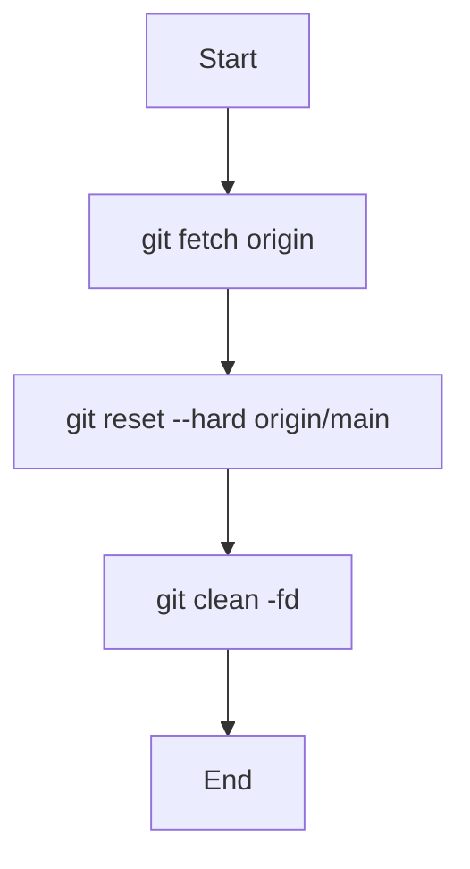

# Git強制同期スクリプト仕様

## 概要
リモートリポジトリ（`origin/main`）の状態をローカルに強制的に反映させるためのスクリプト群です。
競合や未追跡ファイルに悩まされることなく、最新の正解データを取得することを目的としています。

## 配置場所
- `/90_batch/git_force_sync.sh` (Mac/Linux zsh用)
- `/90_batch/git_force_sync.bat` (Windows コマンドプロンプト用)

## 書き方の注意
- `.sh` のコメントは `#` で書く。`/** */` はシェルでは構文エラーになり、スクリプト全体が動かなくなる（`scratch/test_vault_scripts.js` で確認している）。

## 処理フロー

## 各コマンドの詳細

1. **`git fetch origin`**
   - リモートリポジトリの最新の変更内容（コミット、ブランチなど）をローカルのリモート追跡ブランチにダウンロードします。
2. **`git reset --hard origin/main`**
   - 現在のブランチ（通常はmain）を `origin/main` と全く同じ状態に強制リセットします。
   - ローカルで行った未コミットの変更はすべて破棄されます。
3. **`git clean -fd`**
   - gitの管理下にない（追跡されていない）ファイル（-f）およびディレクトリ（-d）を強制的に削除します。

## 注意事項
- **このスクリプトを実行すると、まだプッシュしていないローカルの変更はすべて失われます。**
- 追跡されていないファイルも削除されます。Git に入れていないプラグインのフォルダ（例: `.obsidian/plugins/image-converter/`）とその設定も消えます。
- 重要な変更がある場合は、実行前に別のブランチに待避させるなどの処置を行ってください。
