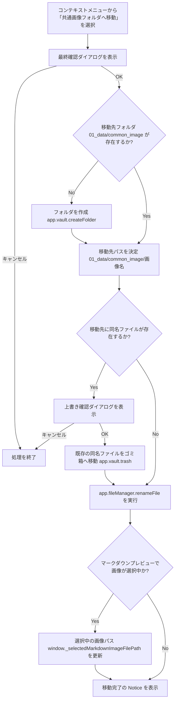

# 仕様書: 画像の共通画像フォルダ（common_image）への移動と重複上書きマージ

## 概要
画像ファイルを右クリックメニューから迅速に共通画像フォルダ（`01_data/common_image`）へ移動できるようにし、その画像を参照しているすべてのマークダウンファイル内のリンクを自動修正（追従）させる。
また、移動先やリネーム先に同名ファイルが既に存在する場合、エラーとせずに既存ファイルをゴミ箱へ移動した上で上書き（マージ）し、双方へのリンクを同一のファイルに安全に統合させる。

## 対象ファイル
- 画像ファイル（拡張子: `png`, `jpg`, `jpeg`, `gif`, `bmp`, `svg`, `webp`, `tif`, `tiff`）

## 移動先パス
- `01_data/common_image/{ファイル名}`

## トリガー箇所
1. ファイルエクスプローラー、またはタブの右クリックコンテキストメニュー（`file-menu` イベント）。
2. マークダウンプレビュー上で画像を右クリックした際のコンテキストメニュー。
3. 共通画像フォルダ内でショートカット `R` による画像リネーム（同名衝突時）。

## 動作フロー

## 技術的要件

### 1. 移動用コア関数 `moveToCommonImage(file)` の上書きマージ
- すでに共通画像フォルダにある画像は、通知だけを出して何もしない（移動先が自分自身になり、下の上書きの処理で自分をゴミ箱へ移してしまうため）。
- `window.confirm` にて移動の最終確認を行う。
- 移動先ディレクトリ `01_data/common_image` が存在しない場合は、`app.vault.createFolder` で自動作成。
- 移動先パス `01_data/common_image/ファイル名` にすでにファイルが存在するか `app.vault.getAbstractFileByPath` でチェックする。
  - 既に存在する場合、上書き確認プロンプト（`window.confirm`）を表示。
  - ユーザーが同意した場合、`app.vault.trash(existingFile, true)` により既存ファイルを安全にシステムのゴミ箱へ退避させ、その後に `app.fileManager.renameFile(file, newPath)` を実行する。
  - これにより、移動元のファイルを指していた既存リンクはObsidianの自動リネーム機能で新しい共通パスへ追従し、元々移動先にあったファイルを指していた既存リンクはパスが変わらないためそのまま機能し続け、シームレスなリンクマージが完了する。
  - ユーザーがキャンセルした場合は処理を中断する。

### 2. 共通画像フォルダ内でのリネーム（同名衝突時の上書きマージ）
- `ImageRenameModal.renameFile` メソッドにおいて、リネーム対象ファイルが共通画像フォルダ（`01_data/common_image`）内にある場合、変更後のパスに同名ファイルが存在するかを検証する（自分自身を除く）。
- 同名ファイルが衝突する場合：
  - 上書き確認プロンプトを表示。
  - 同意があった場合、衝突対象ファイルをゴミ箱へ退避（`app.vault.trash`）させた後に `renameFile` を実行。
  - これにより、リンクを壊さずに画像を安全にマージできる。

### 3. プラットフォーム互換性
- Obsidianのパス操作（`/` 区切り）および `app.vault` / `app.fileManager` API の抽象レイヤーを正しく活用し、macOS および Windows の両OSにおいて互換性を持って動作させる。

