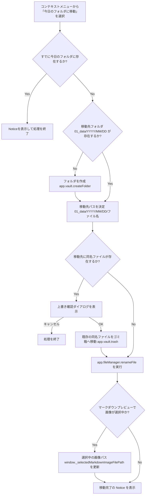

# 仕様書: ファイルの今日のフォルダへの移動と重複上書きマージ

## 概要
ファイルを右クリックメニューから迅速に今日のフォルダ（`01_data/YYYY/MM/DD`）へ移動できるようにし、そのファイルを参照しているすべてのマークダウンファイル内のリンクを自動修正（追従）させる。
また、移動先に同名ファイルが既に存在する場合、エラーとせずに既存ファイルをゴミ箱へ移動した上で上書き（マージ）し、双方へのリンクを同一のファイルに安全に統合させる。

## 対象ファイル
- フォルダーを除くすべてのファイル (`TFile`)。

## 移動先パス
- `01_data/YYYY/MM/DD/{ファイル名}`
  （※ `YYYY/MM/DD` は実行日の日付）

## トリガー箇所
- ファイルエクスプローラー、またはタブの右クリックコンテキストメニュー（`file-menu` イベント）。

## 動作フロー

## 技術的要件

### 1. パス生成ユーティリティ `getTodayFolderPath(now?: Date)`
- `plugins/obsidian-sidebar-explorer/utils.ts` に実装。
- カスタムコマンドのスクリプト側にも同じ内容の `getTodayFolderPath`（`01_common_helpers.js`）があり、今日のフォルダへの移動、タグを引き継いだ新規ノート、draw.io の図の追加が使う。
- ローカルの現在日付（または指定した日付オブジェクト）に基づいて、`01_data/YYYY/MM/DD` 形式のフォルダパス文字列を返す。
- ユニットテスト (`utils.test.ts`) を用意し、TDDで実装を保証。

### 2. 移動用コア関数 `moveToTodayFolder(file)` 
- 対象がファイル（フォルダー以外）であることを `file instanceof TFile` にて確認し、右クリックメニュー（`handleFileMenu`）に「今日のフォルダに移動」項目を追加。
- ターゲットフォルダ `01_data/YYYY/MM/DD` が存在しない場合は、`app.vault.createFolder` で自動作成。
- 移動先パス `01_data/YYYY/MM/DD/ファイル名` にすでにファイルが存在するか `app.vault.getAbstractFileByPath` でチェックする。
  - 既に存在する場合、上書き確認プロンプト（`window.confirm`）を表示。
  - ユーザーが同意した場合、`app.vault.trash(existingFile, true)` により既存ファイルを安全にシステムのゴミ箱へ退避させ、その後に `app.fileManager.renameFile(file, newPath)` を実行する。
  - ユーザーがキャンセルした場合は処理を中断する。
- 移動成功時に `Notice` を表示する。
- フォルダの作成、同名ファイルの確認と上書き、移動、選択中の画像のパスの付け替えは、共通画像フォルダへの移動と同じ処理（`moveFileToFolder`）を使う。

### 3. プラットフォーム互換性
- Obsidianのパス操作（`/` 区切り）および `app.vault` / `app.fileManager` API の抽象レイヤーを正しく活用し、macOS および Windows の両OSにおいて互換性を持って動作させる。
