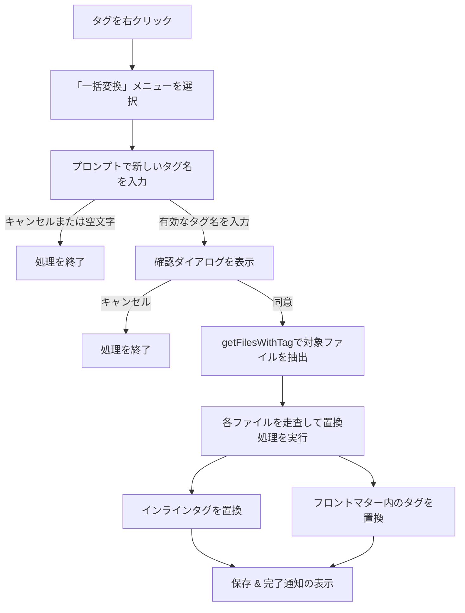

# 仕様書: タグの一括置換（結合・リネーム）機能

## 概要
タグペインやノート内でタグを右クリックした際に表示されるメニュー（`tag-menu`）に「一括変換」オプションを追加します。この機能を使用することで、指定されたタグを別の新しいタグ名（または結合したい既存のタグ名）に一括して置換（結合またはリネーム）することができます。

## 動作フロー

## 詳細動作仕様

### 1. メニュー追加とトリガー
- タグを右クリックした際に発火する `tag-menu` イベントをキャッチし、「一括変換」メニューを追加します。
- このメニューは、右クリックメニュー内でソートされ、「MOCを作成」や「ノート一覧を追加」と同様に最上部に表示されます。

### 2. タグ名の入力（UX改善）
- 入力UIには、Obsidianの標準 `Modal` クラスをベースにしたカスタムモーダル `TagRenameModal` を使用します。
- **自動フォーカス & 全選択**: モーダルが表示された瞬間、入力ボックスに自動的にフォーカスが当たり、かつ既存のタグ名が最初から**全選択（`select()`）された状態**になります。これにより、ユーザーは `Backspace` キー等で文字を消す手間なく、キーボードから新しいタグ名を即座に入力して上書きできます。
- **キーボード操作のサポート**: 新しいタグ名を入力後、`Enter` キーを押すだけで変換が確定されます。

### 3. タグ名の正規化と判定
- 元のタグ名および入力されたタグ名は、先頭の `#` を除去した「正規化タグ名」に統一して処理されます。
- 入力値が空欄である場合、または置換前と置換後のタグ名が同じ（大文字小文字を区別せず一致）である場合は、無効な入力とみなして処理を終了します。

### 4. ファイル走査と置換処理
- `app.vault.getMarkdownFiles()` から抽出された非Excalidrawマークダウンファイルのうち、置換対象のタグを含むファイルを走査します。
- **インラインタグの置換**:
  - `metadataCache` よりファイル内のタグの `position`（位置）情報を取得し、本文内の `#旧タグ名` を `#新タグ名` に置換します。
  - YAMLフロントマターの範囲内（`cache.frontmatterPosition` の中）にあるタグの `position` はインライン置換の対象外とします（二重置換防止）。
  - 文字列置換時のオフセットズレを防ぐため、位置情報の後ろ（オフセット降順）から順に置換処理を適用します。
  - その位置にある文字列が置き換えるタグそのものであることを確かめてから置換します（ノートを書き換えた直後はキャッシュの位置が本文とずれていることがあり、ずれた位置の別の文字列を壊さないため）。
- **フロントマター（YAML）の置換**:
  - `app.fileManager.processFrontMatter` を利用してフロントマターを安全に読み書きします。
  - `tags` プロパティが配列の場合は、該当タグを置換し、さらに大文字小文字を区別しない重複排除（ユニーク化）を適用して、同一ノート内に同じタグ（大文字小文字の違い含む）が複数存在しないように1つに統合（マージ）します。
  - `tags` プロパティが文字列の場合は、該当タグであれば置換を行います。

## 技術的要件
- 実装ファイル:
  - [RegisterCustomCommands.md](file:///Users/mine/000_work/obsidian-dagnetz/00_templates/RegisterCustomCommands.md)（標準タグペイン/MOCメニュー連携用）
  - [obsidian-sidebar-explorer-tag/view.ts](file:///Users/mine/000_work/obsidian-dagnetz/.obsidian/plugins/obsidian-sidebar-explorer-tag/view.ts)（自作サイドバープラグイン用）
- テストファイル: [test_tag_bulk_rename.js](file:///Users/mine/000_work/obsidian-dagnetz/scratch/test_tag_bulk_rename.js)
- イベント管理: `window._customTagMenuListener` によりイベントリスナーの重複登録を防止。
